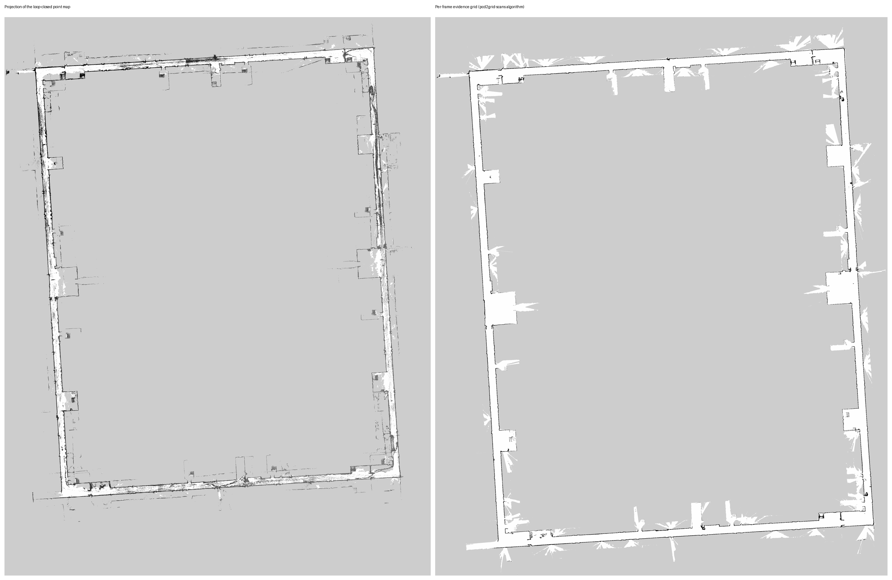
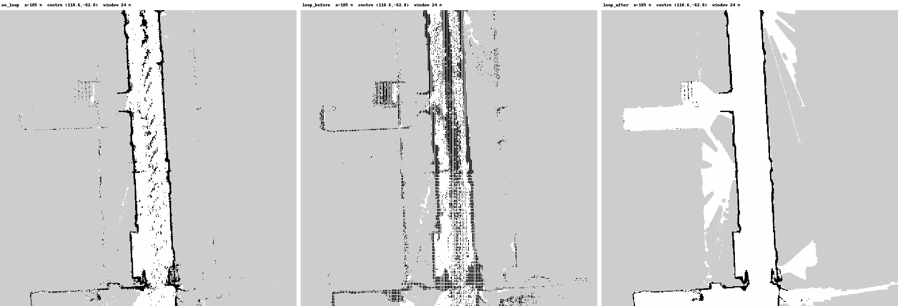
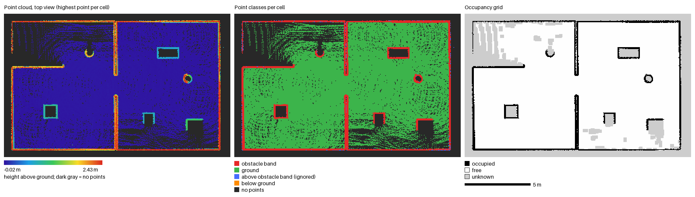
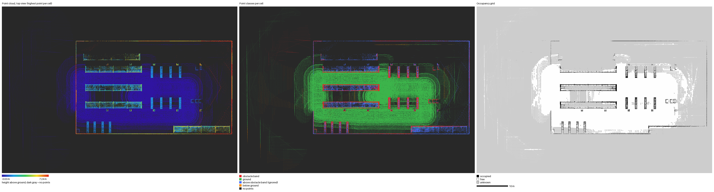
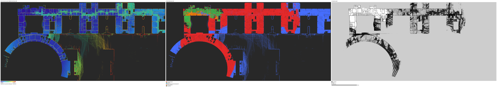
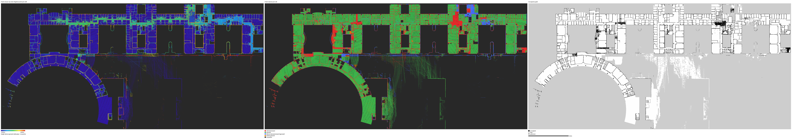

# pcd2grid

**English** | [简体中文](README.zh-CN.md)

Convert 3D point cloud maps (PCD, PLY, LAS/LAZ, NPY) into 2D occupancy grids (`.pgm` + `.yaml`) that ROS 2 Nav2 `map_server` can load.

The tool uses height-band projection:

1. Estimate the ground (one global plane, per-tile local planes, or none).
2. Cells with at least `--min-points` points whose height above ground lies in `[--obs-min, --obs-max]` are occupied.
3. Cells that contain ground points and are not occupied are free.
4. All other cells are unknown.

It has no ROS dependency; it uses numpy, scipy, Pillow and PyYAML.

## Install

```bash
pip install -e .            # core
pip install -e ".[las]"     # adds LAS/LAZ support through laspy
```

## Usage

```bash
pcd2grid map.pcd out/office --res 0.05 --obs-min 0.1 --obs-max 0.7
```

This writes `out/office.pgm`, `out/office.yaml` and `out/office_preview.png`.

The output map uses the same frame as the input cloud (for FAST-LIO2 that is `camera_init`), unless you change it with `--up-axis`, `--transform` or `--origin`.

### Common options

| Option | Meaning |
| --- | --- |
| `--res` | Cell size in metres (default 0.05) |
| `--obs-min`, `--obs-max` | Obstacle height band above ground, in metres |
| `--ground-mode` | `plane` (default), `grid` (per-tile planes for ramps and uneven floors), `none` (absolute z) or `auto` (`grid` when the cloud's long side exceeds `--auto-ground-size`, otherwise `plane`) |
| `--tile` | Tile size for `--ground-mode grid` |
| `--auto-ground-size` | Long-side threshold in metres for `--ground-mode auto` (default 100) |
| `--level` | Detect the floor plane and rotate the cloud so it is horizontal; the rotation is saved to `<prefix>_level.txt` |
| `--ground-z` | Approximate floor height to start the ground fit from, if the automatic choice is wrong |
| `--max-cells` | Refuse grids larger than this (default 100 million cells) |
| `--up-axis` | Input axis that points up: `x`, `y`, `z`, `-x`, `-y`, `-z` |
| `--transform` | 4x4 matrix (txt/npy file or 16 numbers) applied after `--up-axis` |
| `--crop` | Crop box `xmin,xmax,ymin,ymax,zmin,zmax` (leave a value empty to keep it open) |
| `--z-slab` | Keep only one absolute height range, for example one floor |
| `--voxel` | Voxel downsampling size in metres |
| `--inflate` | Obstacle inflation radius in metres |
| `--origin`, `--origin-yaw` | Force the lower-left corner and the yaw written to the yaml |
| `--mode` | `trinary` (default), `scale` or `raw` |
| `--npy` | Also write an occupancy array (0..100, -1 unknown) |
| `--no-preview` | Skip the preview PNG |
| `--compare` | Also write `<prefix>_compare.png` (see below) |

Run `pcd2grid --help` for the full list.

## Development features (next release)

Existing `plane` and tiled `grid` modes retain their behavior. The tiled implementation
already sorts point indices once and slices each tile; it no longer scans all points
for every tile. Sorting is O(N log N), followed by grouped processing, not strictly O(N).
A regression test checks exact agreement with the legacy per-tile mask implementation.

### Continuous ground and cleanup

```bash
pcd2grid map_3d.pcd maps/heightmap --res 0.1 --voxel 0.1 \
  --ground-mode heightmap --ground-cell 0.5 --ground-smooth 0.5 \
  --min-obstacle-area 0.03 --min-free-area 0.1 \
  --start 0,0 --robot-radius 0.25 --report maps/heightmap.json
```

`heightmap` builds a per-cell minimum-height envelope, compensates minima to cell
centers using local slopes, fills missing heights from the nearest observed cell,
then applies a 3x3 median filter and Gaussian smoothing. Point heights are sampled
bilinearly. `--ground-cell` and `--ground-smooth` are in metres. This is an optional
single-floor model, not a guaranteed floor detector: isolated low outliers, elevated
surfaces without floor returns, large holes and overlapping storeys can still fail.
Crop to one storey and inspect the result before navigation. `--ground-z` seeds only
plane/grid modes and does not constrain the heightmap.

Component thresholds are in square metres and use four-connectivity. Both default
to zero (disabled); removing small obstacles can remove real thin objects. Removed
obstacles become unknown, never automatically free, even with ground returns below
them. Small free components also become unknown. Cleanup runs before inflation.

Connectivity is measured only in known free space; unknown and occupied cells,
including space outside the grid, block motion. `--start X,Y` is in the **output map
frame**, not the original point-cloud frame. An invalid start is reported explicitly
instead of being snapped to another region. `--robot-radius` checks circular-robot
clearance on the final map without altering it; it is not a Nav2 planner or a
polygon-footprint feasibility guarantee. Existing `--inflate` therefore adds to
this clearance conservatism. `--report` stores the command parameters, warnings
and statistics as JSON; its parent directory must already exist (the map output
directory is created automatically).

### Trajectory raycasting (experimental)

```bash
pcd2grid map_3d.pcd maps/rays --ground-mode heightmap \
  --trajectory estimated.tum --ray-range 10 --max-rays 200000
```

The TUM trajectory must be in the cloud frame. Its positions undergo the same
up-axis, explicit transform and levelling as the points. Sensor orientation is not
used. Rays are bounded by `--ray-range` (3D metres), deduplicated by endpoint XY cell
and sampled deterministically to `--max-rays`. Only ground/obstacle-band endpoints
participate. Each endpoint is associated with its nearest trajectory position in
3D, **not its actual acquisition pose**: a fused PCD has no scan timestamps or
per-frame rays. Rays stop at existing obstacles (including diagonal corner gaps),
and **never clear occupied cells**. Do not interpret them as confirmed visibility
or use them to erase ghosts. Safe temporal clearing requires timestamped scans,
poses and sensor calibration, not `estimated.tum` plus a fused map alone.

No new SLABIM accuracy or navigation improvement is claimed from these features.
In particular, more free cells is not proof of a more accurate map.

### Per-frame evidence grids (`pcd2grid-scans`)

A fused point cloud cannot tell a wall from a person who walked past once. `pcd2grid-scans` builds the grid from the individual scans and their poses instead, and accepts a cell as occupied only when several frames support it.

```bash
pcd2grid-scans scans/ trajectory.tum maps/corridor --sensor-to-body lidar_to_base.txt
```

Input:

- `scans/`: one point cloud per frame, in the **sensor frame** (`.pcd`, `.ply`, `.npy`, `.las`, `.laz`).
- `trajectory.tum`: a TUM trajectory (`t x y z qx qy qz qw`) with the pose of the sensor frame in a **level world frame** (z up, one floor). If the poses belong to another frame, for example the robot base, pass the 4x4 transform from the cloud frame to that frame with `--sensor-to-body` (txt/npy file or 16 numbers).
- Frames and poses are paired by timestamp when every file name carries one: a plain number in seconds (`1793427856.1.pcd`) or `<index>_<unix time>` such as `003136_1793427856000031948.pcd`, where the time is in s, ms, us or ns. Frames with no pose within `--max-dt` (default 0.05 s) are skipped and reported. Otherwise frames are paired by order, which needs equal counts. `--match stamp` or `--match order` forces one of the two.

How a cell is classified:

1. Height is measured from the floor under the sensor of each frame. The sensor height is estimated from the scans (lowest strong peak of the heights within 4 m) or given with `--sensor-height`; the output states which one was used.
2. A cell is **occupied** if obstacle-height points (`--obs-min` to `--obs-max`) were seen in it in at least `--min-hits` frames, those frames span at least `--min-span` m of the path, and the hits are at least `--occ-ratio` of the hits plus the beams of other frames that passed through the cell.
3. A cell is **free** if a frame saw the floor there, at least two beams passed through it, or it lies within `--robot-radius` of the trajectory. Everything else is unknown.
4. Points farther than `--map-range` (default 20 m) from the sensor are not used, because angular error grows with range.

| Option | Default | Meaning |
| --- | --- | --- |
| `--res` | 0.05 | Cell size, m |
| `--map-range` | 20 | Points farther from the sensor are ignored, m |
| `--obs-min`, `--obs-max` | 0.10, 0.70 | Obstacle height band above the local floor, m |
| `--ground-tol` | 0.05 | Height below which a point counts as floor, m |
| `--scan-stride` | 2 | Use every n-th frame |
| `--ray-deg` | 0.5 | Azimuth bin of the free-space rays, degrees |
| `--min-hits` | 4 | Frames that must see an obstacle point in the cell |
| `--min-span` | 1.0 | Path length between the first and last frame that hit the cell, m |
| `--occ-ratio` | 0.10 | Minimum hits / (hits + beams that passed through) |
| `--robot-radius` | 0.3 | Cells this close to the trajectory are free, m; 0 disables |
| `--closing` | 2 | Iterations of the 3x3 closing of free space |
| `--sensor-height` | 0 | Sensor height above the floor, m; 0 estimates it |
| `--max-cells` | 40,000,000 | Refuse grids larger than this before cropping |

It also accepts `--mode`, `--npy`, `--no-preview`, `--save-evidence` and `--report`; run `pcd2grid-scans --help` for the full list. The yaml uses `free_thresh: 0.15`, like `pcd2grid`.

#### Example: HEU61 corridor loop

A wheeled robot drove one loop (about 620 m) through the corridors of a building with a 96-ring front lidar. The poses come from FAST-LIO2 followed by an offline planar loop-closure step. The command and its output with the default parameters, run on the raw front-lidar PCD files of that recording:

```bash
pcd2grid-scans front_lidar/ traj_loop.tum maps/corridor --sensor-to-body front_to_body.txt
```

```text
  283 of 10943 frames have no pose and are skipped
frames: 10660 matched, 5330 used; sensor height 0.49 m (estimated)
grid 3023 x 4003 cells (151.2 m x 200.2 m), occupied 0.8%, free 9.3%
```

The images below were made from the same recording and poses with the same algorithm, using the FAST-LIO2 body-frame scans recorded by the author's robot console (3309 x 4096 cells, occupied 0.6%, free 9.4%).

Whole map. Left: the loop-closed point map projected with the height band. Right: the evidence grid.



A corridor junction, 24 m window. Left: point-map projection from odometry poses without loop closure. Middle: the same projection with loop-closed poses. Right: the evidence grid.



The walls become thin continuous lines and the scattered points inside the corridor disappear. The fan-shaped free areas outside the walls are beams that passed through open doors or glass into rooms; they are free by the rule above, not verified free space. The large unknown area in the middle is real: the robot only drove along the corridors.

What this does and does not show:

- It is a visual comparison on one recording from one robot in one environment. There is no ground truth, and it has not been loaded in Nav2 for navigation.
- The default parameters (20 m range, 4 hits, 1 m span, 0.10 ratio) were tuned on this data. On a different sensor or environment they may need changes.
- The 22 unit tests use a synthetic room with a box and a short-lived object; they check the logic, not accuracy on real scenes.

Limitations:

- The poses must already be in a level world frame (z up). There is no levelling and no multi-floor support. Pose errors go directly into wall positions: a drifting or doubled trajectory gives doubled walls.
- Moving objects are removed only if they are seen in too few frames or too short a stretch of path; slow or standing people can stay.
- Raw scans are used as they are, with no motion deskewing.
- The sensor height is one value for the whole run.

This replaces the experimental `--trajectory` ray casting of `pcd2grid` when the real per-frame scans and poses are available.

### BIM/grid evaluation

```bash
pcd2grid-eval maps/heightmap.yaml bim/floor.yaml \
  --transform map_to_bim.txt --output maps/heightmap_eval.json
```

The transform maps prediction world coordinates to BIM/ground-truth world
coordinates. It must be a planar rigid 4x4 transform. YAML map origins, including
yaw, and differing resolutions are respected; prediction classes are sampled at
ground-truth cell centers without automatic registration. Use independently
verified alignment, and evaluate uninflated maps when measuring wall geometry.
The JSON distinguishes full known-ground-truth (sampled at truth cell centers)
and jointly-known support (sampled at prediction cell centers); missing
or unknown predictions are not hits. Undefined ratios are JSON null, not NaN.
Optional `--doors doors.json` accepts a list of objects with `start` and `end` XY
coordinates in the BIM frame; `--robot-radius` checks those point pairs with a
circular footprint. This tests global pair connectivity, not whether a particular
local doorway is open; pairs should straddle the doorway and exclude alternate
routes if doorway-specific correctness is required. No measured BIM metrics are
included until the actual truth grid and alignment have been verified.

## Supported formats

- PCD: ASCII, binary and binary_compressed
- PLY: ASCII and binary (little/big endian), vertex positions only
- LAS/LAZ: needs the optional `laspy` dependency
- NPY: an (N, 3+) array whose first three columns are XYZ

## Checking a result

`--compare` writes three panels side by side, all on the same grid, so the same pixel is the same place in every panel:

1. Point cloud top view: each cell shows its highest point, coloured by height above ground.
2. Point classes: red = obstacle band, green = ground, blue = above the band (ignored, e.g. ceiling), orange = below ground.
3. The occupancy grid that was written.

Typical problems are easy to spot: walls that are red in panel 2 but missing in panel 3 need a lower `--min-points`; a floor that is blue or orange means the ground estimate is wrong (try `--level` or `--ground-z`).

## Examples

The office and warehouse maps were built with FAST-LIO2 in Gazebo Fortress simulation (diff-drive robot, 16-beam LiDAR 0.3 m above the base) and converted with the default settings. The grids were then used as Nav2 maps with AMCL localisation.

### Office

Two rooms with a doorway, desks, a round column and a cabinet. 804,344 points.

```bash
pcd2grid sim_office_04.pcd maps/office --compare
```

```text
ground plane tilt 0.30 deg, height -0.070 m at the origin
grid 345 x 219 cells (17.2 m x 11.0 m), occupied 5.8%, free 69.8%
```



Walls and furniture fall in the obstacle band (red, middle) and become occupied cells (black, right). The floor is green in the middle panel and free in the grid. The gray patches inside the desks and cabinet are cells the LiDAR never saw. In Nav2 tests on this map, the robot reached 6 of 6 goals.

### Warehouse

A 75 m x 54 m warehouse with long shelving rows, shelf units and pallets. 1,811,663 points.

```bash
pcd2grid sim_wh_01.pcd maps/warehouse --compare
```

```text
ground plane tilt 0.65 deg, height -0.134 m at the origin
grid 1509 x 1074 cells (75.5 m x 53.7 m), occupied 1.1%, free 19.6%
```



Only points between 0.1 m and 0.7 m above the floor count as obstacles. Where the LiDAR saw only the upper shelf levels, the cells are blue (ignored) in the middle panel; the shelf edges that reach down into the band are red and outline the shelves in the grid. The speckled areas around the building come from sparse returns outside the walls. In Nav2 tests on this map, the robot reached 7 of 7 goals.

The warehouse scene is the Gazebo Fuel world "Tugbot in Warehouse" with models by OpenRobotics and MovAi, licensed CC BY-NC 4.0 and CC BY-NC-ND 4.0. Only a map derived from the simulation is shown here; no model files are included.

### SLABIM 4F: global versus local ground

This example uses a **simulated LiDAR map**, not points sampled directly from BIM surfaces. A robot scanned a Gazebo scene derived from the SLABIM HKUST main-building 4F BIM meshes, and FAST-LIO2 produced a 5,755,840-point map in its `camera_init` frame. The acquisition route covered the connected region reachable from the start, not every part of the storey.

The run exhibited substantial vertical drift (approximately 3 m maximum estimated height deviation). It is a challenging conversion example, **not a navigation-quality mapping benchmark**.

Both conversions use the same input, 0.1 m grid resolution and 0.1 m voxel downsampling. Other settings retain their defaults, including the 0.1–0.7 m obstacle height band. Local mode fits a separate ground plane in each 5 m tile.

```bash
pcd2grid map_3d.pcd maps/slabim_global --res 0.1 --voxel 0.1 --compare
pcd2grid map_3d.pcd maps/slabim_local --res 0.1 --voxel 0.1 --ground-mode grid --tile 5 --compare
```

| Ground model | Grid size | Occupied cells | Free cells |
| --- | --- | --- | --- |
| Global plane | 3262 × 1570 | 7.5% | 2.3% |
| Local planes (5 m tiles) | 3262 × 1570 | 2.8% | 22.8% |

**Global plane:**



**Local planes:**



Local ground estimation recovers more continuous floor regions and clearer room and corridor outlines. A single global plane misclassifies much of the height-varying floor as obstacles or ignores it. However, a larger free-cell percentage alone is not an accuracy measure: local planes do not correct SLAM drift, align duplicate surfaces or guarantee doorway connectivity. Black clusters, incomplete walls and unknown regions remain; neither output has been validated in Nav2 navigation.

Source geometry: [SLABIM dataset](https://huggingface.co/datasets/BobH62/SLABIM), Huang et al., *SLABIM: A SLAM-BIM Coupled Dataset in HKUST Main Building*, ICRA 2025 ([paper](https://arxiv.org/abs/2502.16856)). Only conversion-result images are included here; the BIM meshes and input point cloud are not redistributed.

## Tilted maps

LiDAR-inertial SLAM systems such as FAST-LIO2 use the first IMU pose as the map frame. If the sensor is mounted at an angle, the whole map is tilted, and a horizontal height band cuts through the floor. pcd2grid checks the floor tilt on every run and prints a warning above 5 degrees. Pass `--level` to rotate the cloud first. The rotation is about the origin, so the map origin still matches the SLAM start pose, but the map axes are now gravity-aligned. Use `<prefix>_level.txt` if you need to relate the two frames.

## How the floor is found

The floor is taken as the lowest strong peak of the height histogram, not the highest one, because in a room scanned from a tripod the ceiling often has more points than the floor. If this still picks the wrong surface, pass `--ground-z` with a rough floor height.

## Verification

- Simulated FAST-LIO2 office and warehouse maps: output is identical, cell for cell, to the maps produced by the original `pcd_to_grid.py` and used in Nav2 navigation tests.
- All three map modes were loaded with Nav2 `map_server` (ROS 2 Humble): free cells read 0, occupied cells 100 and unknown cells -1.
- Real data: PCL sample room scans (`binary_compressed` PCD), an M3DGR FAST-LIO2 map (tilted 28 degrees, converted with `--level`), and laspy LAS/LAZ samples.
- `--ground-mode grid` was tested on synthetic ramps, near-flat maps and the vertically drifting SLABIM simulated scan above. This does not establish accuracy on real uneven terrain or navigation safety.

## Origin

The algorithm comes from `pcd_to_grid.py`, written for a LiDAR SLAM thesis project.

## Tests

```bash
pip install -e ".[dev]"
pytest
```

## License

Apache-2.0
