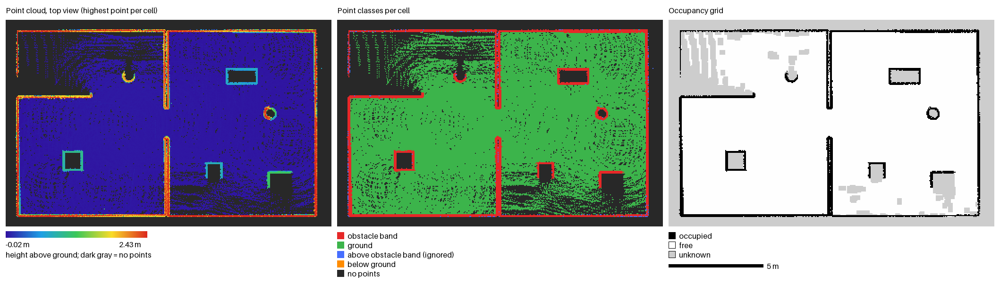
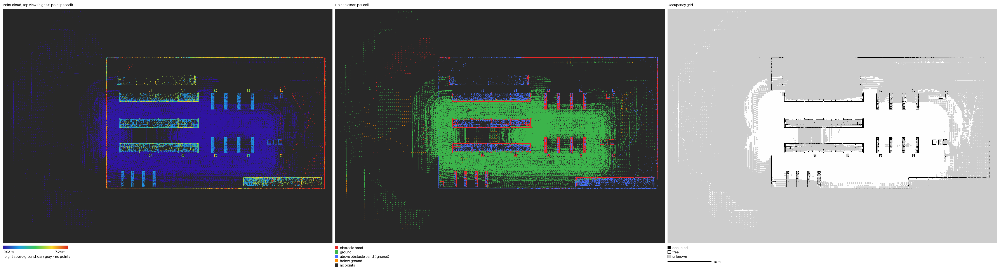
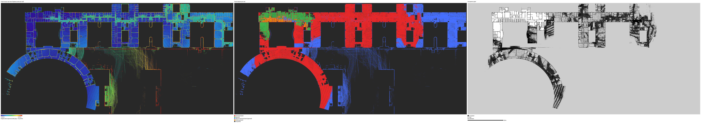
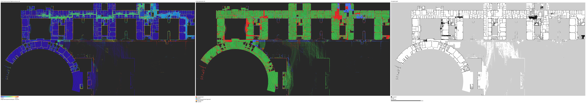

# pcd2grid

Convert 3D point cloud maps (PCD, PLY, LAS/LAZ, NPY) into 2D occupancy grids (`.pgm` + `.yaml`) that ROS 2 Nav2 `map_server` can load.

The tool uses height-band projection:

1. Estimate the ground (one global plane, per-tile local planes, or none).
2. Cells with at least `--min-points` points whose height above ground lies in `[--obs-min, --obs-max]` are occupied.
3. Cells that contain ground points and are not occupied are free.
4. All other cells are unknown.

It has no ROS dependency, only numpy, scipy and Pillow.

## Install

```bash
pip install -e .            # core
pip install -e ".[las]"     # adds LAS/LAZ support through laspy
```

## Usage

```bash
pcd2grid map.pcd out/office --res 0.05 --obs-min 0.1 --obs-max 0.7
```

This writes `out/office.pgm`, `out/office.yaml` and `out/office_preview.png`.

The output map uses the same frame as the input cloud (for FAST-LIO2 that is `camera_init`), unless you change it with `--up-axis`, `--transform` or `--origin`.

### Common options

| Option | Meaning |
| --- | --- |
| `--res` | Cell size in metres (default 0.05) |
| `--obs-min`, `--obs-max` | Obstacle height band above ground, in metres |
| `--ground-mode` | `plane` (default), `grid` (per-tile planes for ramps and uneven floors) or `none` (absolute z) |
| `--tile` | Tile size for `--ground-mode grid` |
| `--level` | Detect the floor plane and rotate the cloud so it is horizontal; the rotation is saved to `<prefix>_level.txt` |
| `--ground-z` | Approximate floor height to start the ground fit from, if the automatic choice is wrong |
| `--max-cells` | Refuse grids larger than this (default 100 million cells) |
| `--up-axis` | Input axis that points up: `x`, `y`, `z`, `-x`, `-y`, `-z` |
| `--transform` | 4x4 matrix (txt/npy file or 16 numbers) applied after `--up-axis` |
| `--crop` | Crop box `xmin,xmax,ymin,ymax,zmin,zmax` (leave a value empty to keep it open) |
| `--z-slab` | Keep only one absolute height range, for example one floor |
| `--voxel` | Voxel downsampling size in metres |
| `--inflate` | Obstacle inflation radius in metres |
| `--origin`, `--origin-yaw` | Force the lower-left corner and the yaw written to the yaml |
| `--mode` | `trinary` (default), `scale` or `raw` |
| `--npy` | Also write an occupancy array (0..100, -1 unknown) |
| `--no-preview` | Skip the preview PNG |
| `--compare` | Also write `<prefix>_compare.png` (see below) |

Run `pcd2grid --help` for the full list.

## Supported formats

- PCD: ASCII, binary and binary_compressed
- PLY: ASCII and binary (little/big endian), vertex positions only
- LAS/LAZ: needs the optional `laspy` dependency
- NPY: an (N, 3+) array whose first three columns are XYZ

## Checking a result

`--compare` writes three panels side by side, all on the same grid, so the same pixel is the same place in every panel:

1. Point cloud top view: each cell shows its highest point, coloured by height above ground.
2. Point classes: red = obstacle band, green = ground, blue = above the band (ignored, e.g. ceiling), orange = below ground.
3. The occupancy grid that was written.

Typical problems are easy to spot: walls that are red in panel 2 but missing in panel 3 need a lower `--min-points`; a floor that is blue or orange means the ground estimate is wrong (try `--level` or `--ground-z`).

## Examples

The office and warehouse maps were built with FAST-LIO2 in Gazebo Fortress simulation (diff-drive robot, 16-beam LiDAR 0.3 m above the base) and converted with the default settings. The grids were then used as Nav2 maps with AMCL localisation.

### Office

Two rooms with a doorway, desks, a round column and a cabinet. 804,344 points.

```bash
pcd2grid sim_office_04.pcd maps/office --compare
```

```text
ground plane tilt 0.30 deg, height -0.070 m at the origin
grid 345 x 219 cells (17.2 m x 11.0 m), occupied 5.8%, free 69.8%
```



Walls and furniture fall in the obstacle band (red, middle) and become occupied cells (black, right). The floor is green in the middle panel and free in the grid. The gray patches inside the desks and cabinet are cells the LiDAR never saw. In Nav2 tests on this map, the robot reached 6 of 6 goals.

### Warehouse

A 75 m x 54 m warehouse with long shelving rows, shelf units and pallets. 1,811,663 points.

```bash
pcd2grid sim_wh_01.pcd maps/warehouse --compare
```

```text
ground plane tilt 0.65 deg, height -0.134 m at the origin
grid 1509 x 1074 cells (75.5 m x 53.7 m), occupied 1.1%, free 19.6%
```



Only points between 0.1 m and 0.7 m above the floor count as obstacles. Where the LiDAR saw only the upper shelf levels, the cells are blue (ignored) in the middle panel; the shelf edges that reach down into the band are red and outline the shelves in the grid. The speckled areas around the building come from sparse returns outside the walls. In Nav2 tests on this map, the robot reached 7 of 7 goals.

The warehouse scene is the Gazebo Fuel world "Tugbot in Warehouse" with models by OpenRobotics and MovAi, licensed CC BY-NC 4.0 and CC BY-NC-ND 4.0. Only a map derived from the simulation is shown here; no model files are included.

### SLABIM 4F: global versus local ground

This example uses a **simulated LiDAR map**, not points sampled directly from BIM surfaces. A robot scanned a Gazebo scene derived from the SLABIM HKUST main-building 4F BIM meshes, and FAST-LIO2 produced a 5,755,840-point map in its `camera_init` frame. The acquisition route covered the connected region reachable from the start, not every part of the storey.

The run exhibited substantial vertical drift (approximately 3 m maximum estimated height deviation). It is a challenging conversion example, **not a navigation-quality mapping benchmark**.

Both conversions use the same input, 0.1 m grid resolution and 0.1 m voxel downsampling. Other settings retain their defaults, including the 0.1–0.7 m obstacle height band. Local mode fits a separate ground plane in each 5 m tile.

```bash
pcd2grid map_3d.pcd maps/slabim_global --res 0.1 --voxel 0.1 --compare
pcd2grid map_3d.pcd maps/slabim_local --res 0.1 --voxel 0.1 --ground-mode grid --tile 5 --compare
```

| Ground model | Grid size | Occupied cells | Free cells |
| --- | --- | --- | --- |
| Global plane | 3262 × 1570 | 7.5% | 2.3% |
| Local planes (5 m tiles) | 3262 × 1570 | 2.8% | 22.8% |

**Global plane:**



**Local planes:**



Local ground estimation recovers more continuous floor regions and clearer room and corridor outlines. A single global plane misclassifies much of the height-varying floor as obstacles or ignores it. However, a larger free-cell percentage alone is not an accuracy measure: local planes do not correct SLAM drift, align duplicate surfaces or guarantee doorway connectivity. Black clusters, incomplete walls and unknown regions remain; neither output has been validated in Nav2 navigation.

Source geometry: [SLABIM dataset](https://huggingface.co/datasets/BobH62/SLABIM), Huang et al., *SLABIM: A SLAM-BIM Coupled Dataset in HKUST Main Building*, ICRA 2025 ([paper](https://arxiv.org/abs/2502.16856)). Only conversion-result images are included here; the BIM meshes and input point cloud are not redistributed.

## Tilted maps

LiDAR-inertial SLAM systems such as FAST-LIO2 use the first IMU pose as the map frame. If the sensor is mounted at an angle, the whole map is tilted, and a horizontal height band cuts through the floor. pcd2grid checks the floor tilt on every run and prints a warning above 5 degrees. Pass `--level` to rotate the cloud first. The rotation is about the origin, so the map origin still matches the SLAM start pose, but the map axes are now gravity-aligned. Use `<prefix>_level.txt` if you need to relate the two frames.

## How the floor is found

The floor is taken as the lowest strong peak of the height histogram, not the highest one, because in a room scanned from a tripod the ceiling often has more points than the floor. If this still picks the wrong surface, pass `--ground-z` with a rough floor height.

## Verification

- Simulated FAST-LIO2 office and warehouse maps: output is identical, cell for cell, to the maps produced by the original `pcd_to_grid.py` and used in Nav2 navigation tests.
- All three map modes were loaded with Nav2 `map_server` (ROS 2 Humble): free cells read 0, occupied cells 100 and unknown cells -1.
- Real data: PCL sample room scans (`binary_compressed` PCD), an M3DGR FAST-LIO2 map (tilted 28 degrees, converted with `--level`), and laspy LAS/LAZ samples.
- `--ground-mode grid` was tested on synthetic ramps, near-flat maps and the vertically drifting SLABIM simulated scan above. This does not establish accuracy on real uneven terrain or navigation safety.

## Origin

The algorithm comes from `pcd_to_grid.py`, written for a LiDAR SLAM thesis project.

## Tests

```bash
pip install -e ".[dev]"
pytest
```

## License

Apache-2.0
