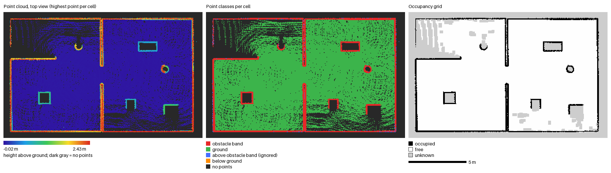
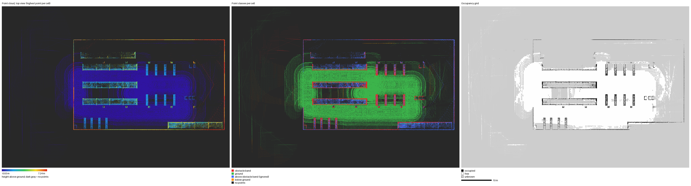
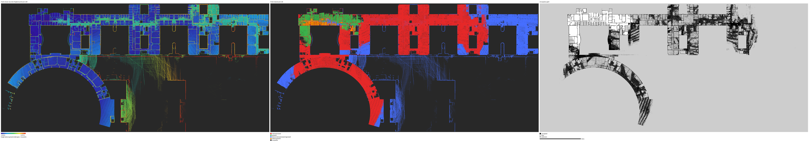
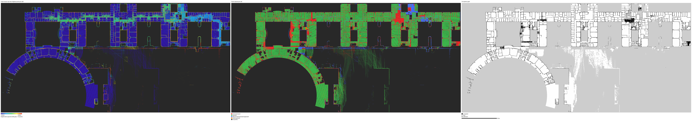
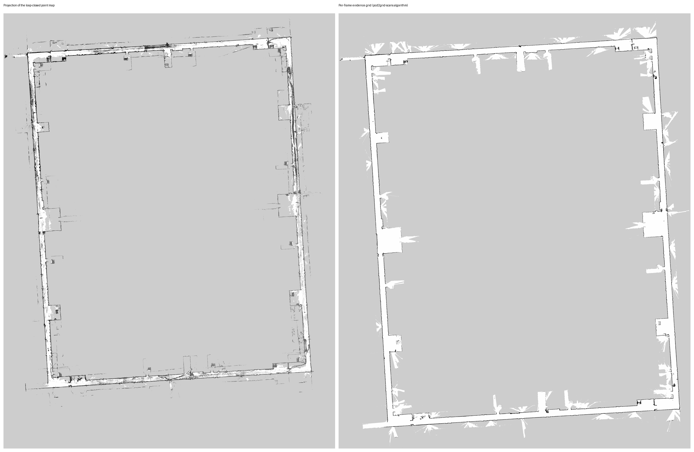
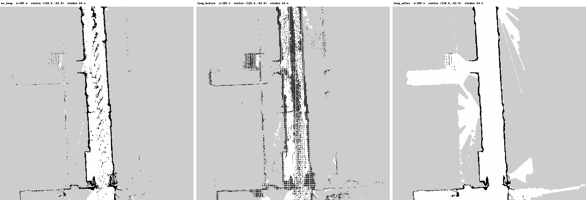

# pcd2grid

[English](README.md) | **简体中文**

将三维点云地图（PCD、PLY、LAS/LAZ、NPY）转换为 ROS 2 Nav2 `map_server` 可加载的二维占据栅格地图（`.pgm` + `.yaml`）。

工具采用基于离地高度区间的投影方法：

1. 估计地面：使用全局平面、分块局部平面，或不进行地面估计。
2. 对每个栅格，统计离地高度位于 `[--obs-min, --obs-max]` 区间内的点；点数达到 `--min-points` 时，将该栅格标记为占据。
3. 包含地面点且未被标记为占据的栅格，标记为空闲。
4. 其余栅格标记为未知。

工具本身不依赖 ROS，仅使用 numpy、scipy 和 Pillow。

## 安装

需要 Python 3.9 或更新版本。在项目根目录执行：

```bash
pip install -e .            # 安装核心依赖
pip install -e ".[las]"     # 通过 laspy 添加 LAS/LAZ 支持
```

## 使用方法

```bash
pcd2grid map.pcd out/office --res 0.05 --obs-min 0.1 --obs-max 0.7
```

该命令会生成 `out/office.pgm`、`out/office.yaml` 和 `out/office_preview.png`。

默认情况下，输出地图沿用输入点云的坐标系；例如，FAST-LIO2 点云通常使用 `camera_init` 坐标系。使用 `--up-axis`、`--transform`、`--level` 或 `--origin` 时，需注意相应的坐标轴、点云坐标或地图原点变化。

### 常用参数

| 参数 | 含义 |
| --- | --- |
| `--res` | 栅格分辨率，单位为米，默认 0.05 |
| `--obs-min`、`--obs-max` | 障碍物相对地面的高度区间，单位为米 |
| `--ground-mode` | `plane`：全局地面平面，默认模式；`grid`：分块局部平面，适用于坡道和不平整地面；`none`：直接使用绝对 z 坐标；`auto`：点云长边超过 `--auto-ground-size` 时使用 `grid`，否则使用 `plane` |
| `--tile` | `--ground-mode grid` 模式的分块边长，单位为米 |
| `--auto-ground-size` | `--ground-mode auto` 切换到分块的长边阈值，单位为米，默认 100 |
| `--level` | 检测地面平面并旋转点云，使地面水平；旋转变换保存至 `<prefix>_level.txt` |
| `--ground-z` | 地面拟合的初始高度参考；自动选择地面有误时，可手动指定大致地面高度 |
| `--max-cells` | 允许生成的最大栅格数，默认 1 亿；超过时拒绝转换 |
| `--up-axis` | 输入点云中朝上的坐标轴：`x`、`y`、`z`、`-x`、`-y` 或 `-z` |
| `--transform` | 在 `--up-axis` 变换之后应用的 4×4 变换矩阵；可传入 txt/npy 文件或 16 个以逗号分隔的数值 |
| `--crop` | 裁剪范围：`xmin,xmax,ymin,ymax,zmin,zmax`；某个值留空表示不限制该方向的边界 |
| `--z-slab` | 仅保留指定绝对高度区间内的点，例如提取某一楼层 |
| `--voxel` | 体素降采样尺寸，单位为米 |
| `--inflate` | 障碍物膨胀半径，单位为米 |
| `--origin`、`--origin-yaw` | 指定地图左下角坐标，以及写入 YAML 的偏航角；偏航角单位为弧度 |
| `--mode` | 地图模式：`trinary`（默认）、`scale` 或 `raw` |
| `--npy` | 额外保存占据栅格数组：0～100 表示占据值，-1 表示未知 |
| `--no-preview` | 不生成 PNG 预览图 |
| `--compare` | 额外生成 `<prefix>_compare.png` 对比图，详见下文 |

完整参数列表可通过 `pcd2grid --help` 查看。

## 支持的文件格式

- **PCD**：ASCII、binary 和 binary_compressed。
- **PLY**：ASCII 和二进制格式，支持小端与大端；仅读取顶点位置。
- **LAS/LAZ**：需要安装可选依赖 `laspy`。
- **NPY**：形状为 `(N, 3+)` 的数组，前三列为 XYZ 坐标。

## 如何检查转换结果

`--compare` 会生成横向排列的三幅对比图。三幅图使用完全相同的栅格，同一像素对应同一空间位置：

1. **点云俯视图**：每个栅格显示其中的最高点，颜色表示离地高度。
2. **点分类图**：红色为障碍物高度区间内的点，绿色为地面点，蓝色为高于障碍物区间的点（忽略，例如天花板），橙色为低于地面的点。
3. **最终输出的占据栅格地图**。

常见问题可以据此判断：如果墙体在第二幅图中为红色，却未出现在第三幅图中，可尝试降低 `--min-points`；如果地面显示为蓝色或橙色，则说明地面估计可能有误，可尝试 `--level` 或 `--ground-z`。

## 示例

以下办公室和仓库点云使用 FAST-LIO2 在 Gazebo Fortress 仿真中构建。机器人为差速驱动，搭载相对底座高度为 0.3 m 的 16 线激光雷达；转换时使用默认参数。生成的栅格地图随后用于 Nav2 导航，并通过 AMCL 定位。

### 办公室

场景包含两个通过门洞相连的房间，以及办公桌、圆柱和柜子。点云共 804,344 个点。

```bash
pcd2grid sim_office_04.pcd maps/office --compare
```

```text
ground plane tilt 0.30 deg, height -0.070 m at the origin
grid 345 x 219 cells (17.2 m x 11.0 m), occupied 5.8%, free 69.8%
```



墙体和家具位于障碍物高度区间内，在中间的分类图中显示为红色，在右侧栅格地图中对应黑色的占据区域。地面在中间图中为绿色，在栅格地图中为空闲区域。办公桌和柜子内部的灰色区域对应激光雷达未观测到的栅格。在该地图的 Nav2 测试中，机器人完成了全部 6 个目标点的导航。

### 仓库

场景为约 75 m × 54 m 的仓库，包含长排货架、独立货架单元和托盘。点云共 1,811,663 个点。

```bash
pcd2grid sim_wh_01.pcd maps/warehouse --compare
```

```text
ground plane tilt 0.65 deg, height -0.134 m at the origin
grid 1509 x 1074 cells (75.5 m x 53.7 m), occupied 1.1%, free 19.6%
```



仅离地高度在 0.1～0.7 m 之间的点被视为障碍物。如果激光雷达只观测到货架上层，这些点在中间图中会显示为蓝色，并被忽略；延伸至障碍物高度区间内的货架边缘则显示为红色，在栅格地图中形成货架轮廓。建筑周围的散点区域来自墙外的稀疏回波。在该地图的 Nav2 测试中，机器人完成了全部 7 个目标点的导航。

仓库场景来自 Gazebo Fuel 世界 “Tugbot in Warehouse”，模型由 OpenRobotics 和 MovAi 提供，采用 CC BY-NC 4.0 和 CC BY-NC-ND 4.0 许可。此处仅展示由仿真生成的地图，不包含模型文件。

### SLABIM 4F：全局地面与局部地面对比

本例使用的是**仿真激光雷达建图结果**，不是直接从 BIM 表面采样得到的点云。机器人在基于 SLABIM 香港科技大学主楼 4 层 BIM 网格构建的 Gazebo 场景中扫描，FAST-LIO2 在 `camera_init` 坐标系下生成了包含 5,755,840 个点的地图。采集路线覆盖了从起点可达的连通区域，并未覆盖整层楼的所有空间。

该次建图存在明显的垂直漂移，估计高度的最大偏差约为 3 m。因此，它是一个具有挑战性的转换示例，**不是用于证明建图结果满足导航要求的基准测试**。

两次转换使用同一份输入点云，栅格分辨率和体素降采样尺寸均为 0.1 m。其他参数保持默认，包括 0.1～0.7 m 的障碍物离地高度区间。局部模式在每个 5 m 分块内分别拟合地面平面。

```bash
pcd2grid map_3d.pcd maps/slabim_global --res 0.1 --voxel 0.1 --compare
pcd2grid map_3d.pcd maps/slabim_local --res 0.1 --voxel 0.1 --ground-mode grid --tile 5 --compare
```

| 地面模型 | 栅格尺寸 | 占据栅格比例 | 空闲栅格比例 |
| --- | --- | --- | --- |
| 全局平面 | 3262 × 1570 | 7.5% | 2.3% |
| 局部平面（5 m 分块） | 3262 × 1570 | 2.8% | 22.8% |

**全局平面：**



**局部平面：**



局部地面估计能恢复更连续的地面区域，使房间和走廊轮廓更清晰。单一全局平面则会将大量高度变化的地面误判为障碍物或直接忽略。但空闲栅格比例增加本身并不能衡量精度：局部平面无法修正 SLAM 漂移、对齐重复表面，也不能保证门洞连通。输出中仍有黑色聚集区域、不完整的墙体和未知区域；两种结果均未经过 Nav2 导航验证。

源几何数据来自 [SLABIM 数据集](https://huggingface.co/datasets/BobH62/SLABIM)，对应 Huang 等人的论文 *SLABIM: A SLAM-BIM Coupled Dataset in HKUST Main Building*，ICRA 2025（[论文](https://arxiv.org/abs/2502.16856)）。本仓库仅包含转换结果图片，不重新分发 BIM 网格和输入点云。

## 逐帧证据栅格（`pcd2grid-scans`，下一版本）

融合后的点云分不清一面墙和一个只路过一次的行人。`pcd2grid-scans` 改为使用逐帧扫描和对应位姿建图，只有多帧都支持的栅格才会被标为占据。

```bash
pcd2grid-scans scans/ trajectory.tum maps/corridor --sensor-to-body lidar_to_base.txt
```

输入：

- `scans/`：每帧一个点云文件，位于**传感器坐标系**（`.pcd`、`.ply`、`.npy`、`.las`、`.laz`）。
- `trajectory.tum`：TUM 轨迹（`t x y z qx qy qz qw`），给出传感器坐标系在**水平世界系**（z 向上、单层楼）中的位姿。如果位姿属于其他坐标系（例如机器人底盘），用 `--sensor-to-body` 传入从点云坐标系到该坐标系的 4×4 变换（txt/npy 文件或 16 个数）。
- 当每个文件名都带时间戳时，按时间戳匹配帧与位姿：可以是以秒为单位的纯数字（`1793427856.1.pcd`），也可以是 `<序号>_<Unix 时间>`，例如 `003136_1793427856000031948.pcd`，时间单位可为秒、毫秒、微秒或纳秒。在 `--max-dt`（默认 0.05 s）内找不到位姿的帧会被跳过并提示。否则按顺序匹配，要求帧数与位姿数相等。`--match stamp` 或 `--match order` 可强制指定方式。

栅格的判定方式：

1. 高度以每一帧传感器正下方的地面为基准。传感器高度默认从扫描中估计（4 m 内点高度的最低显著峰值），也可用 `--sensor-height` 指定；输出会注明使用的是哪一种。
2. **占据**：障碍高度区间（`--obs-min` 到 `--obs-max`）内的点至少在 `--min-hits` 帧中出现在该栅格，这些帧覆盖的路径长度不少于 `--min-span` m，并且命中数占（命中数 + 其他帧射线穿过该栅格的次数）的比例不低于 `--occ-ratio`。
3. **空闲**：某一帧在此看到地面，或至少两条射线穿过，或位于轨迹 `--robot-radius` 范围内。其余为未知。
4. 距传感器超过 `--map-range`（默认 20 m）的点不参与计算，因为角度误差会随距离增大。

| 参数 | 默认值 | 含义 |
| --- | --- | --- |
| `--res` | 0.05 | 栅格分辨率，m |
| `--map-range` | 20 | 超出此距离的点不使用，m |
| `--obs-min`、`--obs-max` | 0.10、0.70 | 相对局部地面的障碍高度区间，m |
| `--ground-tol` | 0.05 | 高度低于此值视为地面，m |
| `--scan-stride` | 2 | 每 n 帧取一帧 |
| `--ray-deg` | 0.5 | 空闲射线的方位角分箱，度 |
| `--min-hits` | 4 | 栅格内必须看到障碍点的帧数 |
| `--min-span` | 1.0 | 首尾命中帧之间的路径长度，m |
| `--occ-ratio` | 0.10 | 命中数 /（命中数 + 射线穿过次数）的下限 |
| `--robot-radius` | 0.3 | 轨迹附近此距离内的栅格为空闲，m；0 表示关闭 |
| `--closing` | 2 | 空闲区域 3×3 闭运算的迭代次数 |
| `--sensor-height` | 0 | 传感器离地高度，m；0 表示自动估计 |
| `--max-cells` | 40,000,000 | 裁剪前栅格数超过此值时拒绝生成 |

另有 `--mode`、`--npy`、`--no-preview`、`--save-evidence` 和 `--report`，完整列表见 `pcd2grid-scans --help`。yaml 中的 `free_thresh` 与 `pcd2grid` 一样为 0.15。

### 示例：HEU61 走廊环线

轮式机器人搭载 96 线前雷达，在一栋建筑的走廊里绕行一圈（约 620 m）。位姿来自 FAST-LIO2 加离线平面回环优化。下面是在这次录制的前雷达原始 PCD 上，使用默认参数运行的命令和输出：

```bash
pcd2grid-scans front_lidar/ traj_loop.tum maps/corridor --sensor-to-body front_to_body.txt
```

```text
  283 of 10943 frames have no pose and are skipped
frames: 10660 matched, 5330 used; sensor height 0.49 m (estimated)
grid 3023 x 4003 cells (151.2 m x 200.2 m), occupied 0.8%, free 9.3%
```

下面的图片来自同一次录制、同样的位姿和同一算法，输入是作者的机器人控制台录下的 FAST-LIO2 机体系扫描（3309 × 4096 格，占据 0.6%，空闲 9.4%）。

整图。左：回环优化后的点云地图按高度区间投影；右：证据栅格。



走廊岔口，24 m 窗口。左：未做回环、仅用里程计位姿的点云投影；中：使用回环位姿的同一投影；右：证据栅格。



墙体变成细而连续的线，走廊内部的散点消失了。墙外的扇形空闲区是射线穿过开着的门或玻璃进入房间形成的，按上述规则被标为空闲，并不是经过验证的空闲空间。中间大片未知区域是真实情况：机器人只沿走廊行驶。

这个示例能说明和不能说明的：

- 这只是对一个机器人、一个环境、一次录制的目视对比，没有真值，也没有在 Nav2 中做过导航验证。
- 默认参数（20 m 范围、4 次命中、1 m 跨度、0.10 比例）是在这份数据上调出来的，换传感器或环境可能需要调整。
- 22 个单元测试使用带一个箱子和一个短暂出现物体的合成房间，检查的是逻辑，而不是真实场景下的精度。

局限：

- 位姿必须已经在水平世界系（z 向上）中，没有调平，也不支持多楼层。位姿误差会直接进入墙的位置：轨迹漂移或重影会造成墙体重影。
- 移动物体只有在出现的帧数过少或路径跨度过短时才会被去除，缓慢移动或停留的行人可能保留。
- 直接使用原始扫描，没有运动去畸变。
- 整次运行只使用一个传感器高度。

在有真实逐帧扫描和位姿时，它可以取代 `pcd2grid` 中实验性的 `--trajectory` 射线功能。

## 倾斜地图处理

FAST-LIO2 等激光雷达惯性 SLAM 系统以首帧 IMU 位姿作为地图坐标系。如果传感器倾斜安装，整张地图也会倾斜，此时水平的高度区间可能切穿地面。

pcd2grid 每次运行都会检查地面倾角，超过 5° 时输出警告。添加 `--level` 可先旋转点云，将地面调平。旋转以坐标原点为中心，因此原点仍对应 SLAM 起始位置，但地图坐标轴已经过重力对齐。需要关联调平前后的坐标系时，可使用 `<prefix>_level.txt` 中的变换。

## 如何识别地面

地面初始高度取自高度直方图中**最低的显著峰值**，而不是点数最多的峰值。这是因为使用三脚架在室内扫描时，天花板的点数往往多于地面。如果仍然选错表面，可通过 `--ground-z` 指定大致地面高度，作为平面拟合的初始参考。

## 验证情况

- **FAST-LIO2 仿真办公室和仓库地图**：输出与原始 `pcd_to_grid.py` 生成并用于 Nav2 导航测试的地图逐栅格完全一致。
- **Nav2 兼容性**：三种地图模式均已通过 ROS 2 Humble 的 Nav2 `map_server` 加载验证；空闲栅格读取为 0，占据栅格为 100，未知栅格为 -1。
- **真实数据**：已测试 PCL 房间扫描示例（`binary_compressed` PCD）、一份倾斜约 28° 的 M3DGR FAST-LIO2 地图（使用 `--level` 转换），以及 laspy 的 LAS/LAZ 示例。
- **局部地面模式**：`--ground-mode grid` 已在合成坡道、近似平坦地图，以及上述存在垂直漂移的 SLABIM 仿真扫描上测试。这不代表其在真实不平整地形上的精度或导航安全性已经得到验证。

## 项目来源

算法源于一个激光雷达 SLAM 毕业设计项目中的 `pcd_to_grid.py` 脚本。

## 测试

```bash
pip install -e ".[dev]"
pytest
```

## 许可证

[Apache-2.0](LICENSE)
